<div align="center">

<picture>
  <source media="(prefers-color-scheme: dark)" srcset="assets/banner.svg">
  <source media="(prefers-color-scheme: light)" srcset="assets/banner-light.svg">
  
</picture>

[](LICENSE)
[](#install)
[](#install)
[](#install)
[](https://uniqai.app/?utm_source=github&utm_medium=readme&utm_campaign=model-router)

**LLM model router: a fast / smart / premium decision table for GPT, Claude, Gemini and Grok, with dated prices and a cost calculator.**

[Quickstart](#quickstart) · [How it works](#how-it-works) · [Examples](#examples) · [Install](#install) · [FAQ](#faq)

</div>

**model-router** is an LLM model router you can read: a decision table that classifies a task into three tiers (fast, smart, premium) by its shape, recommends the cheapest model per provider for OpenAI, Anthropic, Google and xAI, and estimates the cost before you run it. It ships as a Claude Code skill, an `AGENTS.md` section and a Cursor rule, plus two dependency-free Node scripts. We keep this table because the same four model families run side by side in [UniqAI chat](https://uniqai.app/chat?utm_source=github&utm_medium=readme&utm_campaign=model-router), and "which one should answer this" is a question we have to answer on every request. Every price cell in [`data/prices.json`](data/prices.json) carries the vendor's pricing-page URL and a "checked" date; the table was last checked on 2026-10-28, and every number in this README is the committed output of a script in this repo.

| **Classify by shape, not vibes** | **Price it before you run it** | **Prices with receipts** |
|:---|:---|:---|
| Twenty-six weighted rules turn a task description, token counts, call volume and risk into a tier, and print every rule that fired. | A calculator for one model, a tier or all 34 models: cached prefix, batch discount and long-context surcharges included. | Each of the 34 rows has a source URL and a check date; a validator flags stale rows and tiers that disagree with the price band. |

## Quickstart

```bash
git clone https://github.com/uniqaiapp/model-router && cd model-router
node scripts/route.mjs "Classify 50,000 support tickets into billing / bug / feature / other" --input 600 --output 20 --calls 50000 --risk low
```

You get the tier, the reasons, the cheapest model per provider with per-call and total cost, and a fallback one tier up. No install step; Node 18 or newer.

## Demo



## How it works

1. **Shape first.** Four facts drive the tier: input tokens per call, output tokens per call, number of calls, and risk (how bad a wrong answer is). You pass them as flags; defaults are stated in the output.
2. **Rules, summed.** `scripts/lib/classify.mjs` holds the rules. Classification, extraction and bulk wording vote fast; drafting, scoped coding and review vote smart; proofs, architecture, security, legal or medical domains, multi-file agent runs and high risk vote premium. The highest total wins and ties go up. The same table is written out in [`SKILL.md`](SKILL.md) so an agent without Node reaches the same answer by hand.
3. **Cheapest in tier, per provider.** `scripts/lib/prices.mjs` prices the shape against every model in the tier and returns the cheapest for each provider. When a provider has nothing in the tier it steps up and says so (xAI lists no premium-band text model, so it is offered its most capable smart model with the note).
4. **Escalate one tier at a time.** The output names the fallback model one tier up and the single check that would prove the tier passed. The skill tells the agent to step down again once a tier passes an eval; that is where the savings are.

```
task ──► classify (rules + shape) ──► tier ──► cheapest model per provider ──► cost estimate
                                        │
                                        └──► fallback one tier up · two-stage hint when fast and premium signals collide
```

Numbers: tiers are price bands by output price (fast up to $3 per 1M output tokens, smart up to $15, premium above), plus the vendor's own naming. The repo holds no benchmark scores and does not claim that every model in a band performs the same; rows where band and positioning disagree carry a `tier_note`. The full table with sources is in [`references/price-table.md`](references/price-table.md), generated by `node scripts/table.mjs --write`.

## Examples

All outputs below are copied from [`examples/expected/`](examples/) and reproduced by `node tests/run.mjs`.

<details open>
<summary><b>50,000 tickets to classify → fast tier, under $4 at three of four providers</b></summary>

`node scripts/route.mjs "Classify 50,000 support tickets into billing / bug / feature / other" --input 600 --output 20 --calls 50000 --risk low`

```text
task      Classify 50,000 support tickets into billing / bug / feature / other
tier      FAST   (fast 6 · smart 0 · premium 0; confidence high)
why       classification / labelling verb ("classify")                   fast +2
          short expected output (20 tokens)                              fast +1
          high volume (50,000 calls): a cheaper tier compounds           fast +2
          low risk: errors are cheap to catch and retry                  fast +1
assumes   600 input + 20 output tokens per call, 50,000 calls; prices as of 2026-10-28

cheapest fast model per provider (per call → total)
  openai     gpt-5-nano                     $0.000038   →  $1.90
  anthropic  claude-haiku-5-5               $0.000070   →  $3.50
  google     gemini-2.5-flash-lite          $0.000068   →  $3.40
  xai        grok-build-0.1                 $0.000640   →  $32.00

fallback  smart: gemini-3.6-flash ($0.000525 per call, $26.25 total) if fast-tier output fails your check on a sample
```

</details>

<details>
<summary><b>Intermittent deadlock, high risk → premium, and what xAI gets instead</b></summary>

`node scripts/route.mjs "Find the root cause of an intermittent deadlock in the payment service and propose a fix across the codebase" --input 60000 --output 3000 --risk high`

```text
task      Find the root cause of an intermittent deadlock in the payment service and propose a fix across the codebase
tier      PREMIUM   (fast 0 · smart 1 · premium 7; confidence high)
why       architecture or hard debugging ("root cause")                  premium +2
          long-horizon or multi-file agent work ("across the codebase")  premium +2
          long prompt (60,000 tokens) needs reliable attention           smart +1
          high risk: an error is expensive or irreversible               premium +3
assumes   60,000 input + 3,000 output tokens per call, 1 call; prices as of 2026-10-28

cheapest premium model per provider (per call → total)
  openai     gpt-5.6-sol                    $0.3000     →  $0.3000
  anthropic  claude-opus-5-5                $0.3000     →  $0.3000
  google     gemini-4-argon                 $0.1500     →  $0.1500
  xai        grok-4.7                       $0.1380     →  $0.1380   no premium model at xAI; see tier_note: xAI's models page calls it their most capable model, but it is priced in the smart band; xAI lists no premium-band text model, so the router also offers it as the xAI fallback for premium tasks

fallback  none above premium; if this still fails, split the task or add tools, do not just retry
```

</details>

<details>
<summary><b>Fast and premium signals in one task → two-stage hint</b></summary>

`node scripts/route.mjs "Triage every alert from the scanner and write a threat model for the ones that look like a real vulnerability" --input 4000 --output 800 --calls 5000`

```text
task      Triage every alert from the scanner and write a threat model for the ones that look like a real vulnerability
tier      FAST   (fast 4 · smart 0 · premium 2; confidence medium)
why       classification / labelling verb ("triage")                     fast +2
          security-sensitive ("threat model")                            premium +2
          high volume (5,000 calls): a cheaper tier compounds            fast +2
assumes   4,000 input + 800 output tokens per call, 5,000 calls; prices as of 2026-10-28

cheapest fast model per provider (per call → total)
  openai     gpt-5-nano                     $0.000520   →  $2.60
  anthropic  claude-haiku-5-5               $0.000800   →  $4.00
  google     gemini-2.5-flash-lite          $0.000720   →  $3.60
  xai        grok-build-0.1                 $0.005600   →  $28.00

fallback  smart: gemini-3.6-flash ($0.006000 per call, $30.00 total) if fast-tier output fails your check on a sample
hint      mixed signals: run a fast model first to filter or pre-process, send only the hard cases to premium (two-stage routing)
hint      risk not given: validate fast-tier output on a sample before trusting it at volume
```

</details>

<details>
<summary><b>Calculator: a 120k-token prompt on Claude Haiku 5.5 with a cached prefix and batch pricing</b></summary>

`node scripts/cost.mjs --model claude-haiku-5-5 --input 120000 --output 800 --cached 100000 --batch`

```text
model     claude-haiku-5-5  (Anthropic, fast tier)
shape     120,000 input + 800 output tokens per call, 1 call (100,000 cached, batch); prices as of 2026-10-28
prices    in $0.50 · cached $0.05 · out $2.50 per 1M (long_context)
per call  $0.008500   = input $0.005000 + cached $0.002500 + output $0.001000
total     $0.008500   for 1 call
note      long-context prices (prompt >= 100,000 tokens)
note      batch: x0.5 (Anthropic)
source    https://platform.claude.com/docs/en/about-claude/pricing (checked 2026-10-28)
```

The long-context row kicked in because the prompt is over 100,000 tokens, which is why the input price is $0.50 and not $0.10.

</details>

Eleven routed tasks and four calculator runs are listed in [`examples/README.md`](examples/README.md).

## Install

Works with every agent that reads instruction files. Pick yours. Requirements: Node 18+. No packages to install.

<details open>
<summary><b>Claude Code</b></summary>

```bash
# user-level
git clone https://github.com/uniqaiapp/model-router ~/.claude/skills/model-router
# or project-level
git clone https://github.com/uniqaiapp/model-router .claude/skills/model-router
# or with the skills CLI
npx skills add uniqaiapp/model-router
```

Then `/model-router` in any session, or just ask "which model should I use for this" or "what will this cost"; the skill's `description` triggers it. Once the uniqaiapp marketplace is published: `/plugin marketplace add uniqaiapp/skills` then `/plugin install model-router@uniqaiapp`.

</details>

<details>
<summary><b>Cursor</b></summary>

Copy `SKILL.md`, `scripts/`, `data/` and [`.cursor/rules/model-router.mdc`](.cursor/rules/model-router.mdc) into your project. The rule file embeds the skill with `@SKILL.md`.

</details>

<details>
<summary><b>Codex / any AGENTS.md agent</b></summary>

Copy `SKILL.md`, `scripts/` and `data/` into `.agents/skills/model-router/` and append the snippet from [`codex/INSTRUCTIONS.md`](codex/INSTRUCTIONS.md) to your `AGENTS.md`. The repo's own [`AGENTS.md`](AGENTS.md) is a working example.

</details>

<details>
<summary><b>Plain prompt, or no agent at all</b></summary>

Paste [`SKILL.md`](SKILL.md) into the system prompt of any model; it has no agent-specific syntax outside the frontmatter. The scripts also run standalone: `node scripts/route.mjs --help`, `node scripts/cost.mjs --help`.

</details>

## FAQ

<details>
<summary><b>Where do the prices come from, and how stale are they?</b></summary>

From each vendor's own pricing page, copied by hand: OpenAI, Anthropic, Google AI (Gemini API) and xAI. Every row in `data/prices.json` has the URL and the date it was checked; the whole table was checked on 2026-10-28. `node scripts/check.mjs` warns about rows older than 90 days. Promotional prices with an end date and long-context surcharges are stored next to the standard price, and the calculator picks the right one.

</details>

<details>
<summary><b>Is "fast / smart / premium" a quality ranking?</b></summary>

No. Tiers are price bands by output price plus the vendor's own naming (nano, flash, haiku against pro, opus, astra). The repo holds no benchmark scores and does not claim that models inside a band perform alike. The router orders models within a tier by cost for your shape; your own sample decides between providers.

</details>

<details>
<summary><b>What if the cheap model gets it wrong?</b></summary>

Every result names the fallback one tier up and the single check that proves the tier passed (exact match on labels, tests green, a reviewer spot-check). The skill's rule is: validate on a sample, escalate one tier at a time, and once a tier passes, try the tier below before committing.

</details>

<details>
<summary><b>Can I add my own provider or an internal price list?</b></summary>

Yes. Add rows to `data/prices.json` (or point the scripts at another file with `--prices`), run `node scripts/check.mjs`, then `node scripts/table.mjs --write`. Rows need a `source` URL and a `checked` date; the validator refuses rows without them.

</details>

<details>
<summary><b>Does it count tokens?</b></summary>

Roughly: `--file prompt.txt` estimates chars / 4 and says so in the output. For billing-grade numbers use the vendor's token counter and pass the count with `--input`.

</details>

## Limits and honesty

- The classifier matches English task wording and the four shape flags; it does not read your data. A vague description gets the smart default with low confidence.
- No quality data of any kind. Ties between providers are ties.
- Image, video, audio and embedding prices are out of scope; so are self-hosted models.
- All dollar figures above are produced by `node scripts/regen-examples.mjs` on the committed price table and checked byte-for-byte by the tests. If the table changes, the figures change with it.

## Related

- [token-diet](https://github.com/uniqaiapp/token-diet): cut prompt and context tokens without losing meaning; the other half of the bill.
- [skill-shrinker](https://github.com/uniqaiapp/skill-shrinker): shrink any SKILL.md or agent instruction file so the agent loads fewer tokens per turn.
- [ai-video-pricing](https://github.com/uniqaiapp/ai-video-pricing): the same "source URL and check date on every row" rule, applied to AI video prices per second.

## Contributing

Issues and pull requests are welcome; price corrections with the vendor URL and date are the most useful kind. See [CONTRIBUTING.md](CONTRIBUTING.md) for the local checks (`node tests/run.mjs`, `node scripts/check.mjs`, no dependencies).

## License

[MIT](LICENSE) © UniqAI

---

<div align="center">

<sub>Made by <a href="https://uniqai.app/?utm_source=github&utm_medium=readme&utm_campaign=model-router">UniqAI</a> — Kling 3.0, Veo 3, Flux, Nano Banana and GPT-5/Claude/Gemini/Grok in one app.</sub>

</div>
